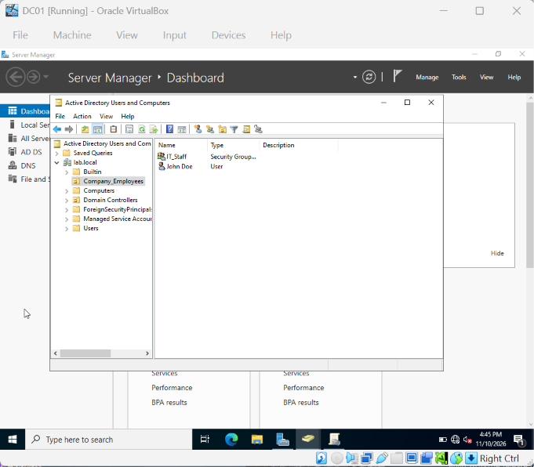
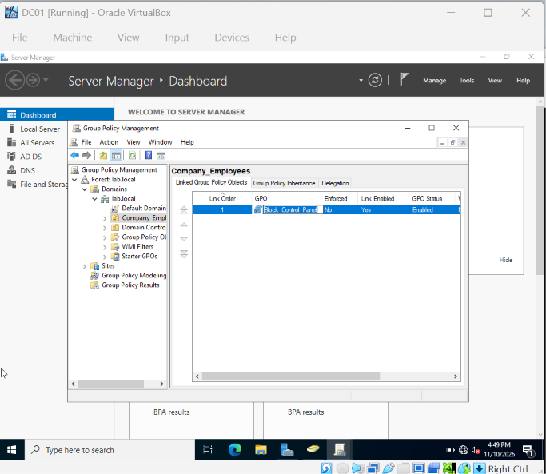
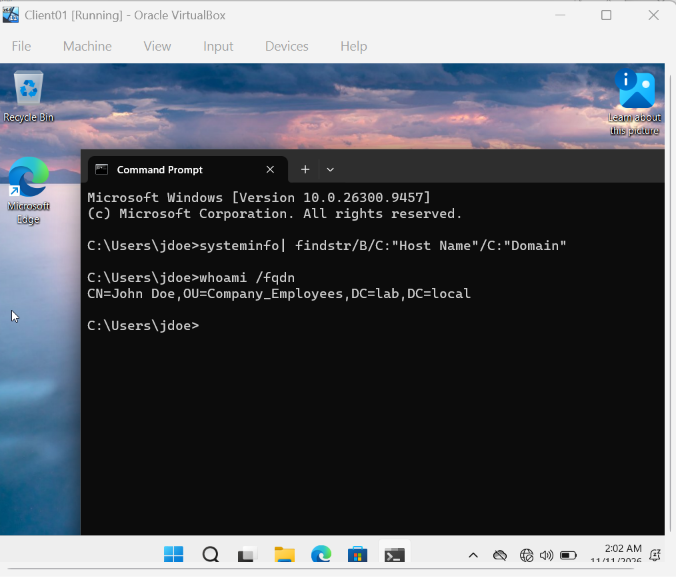
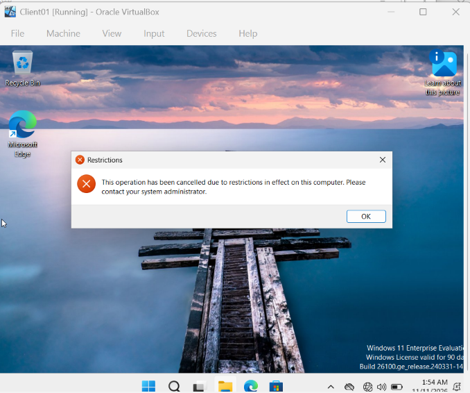
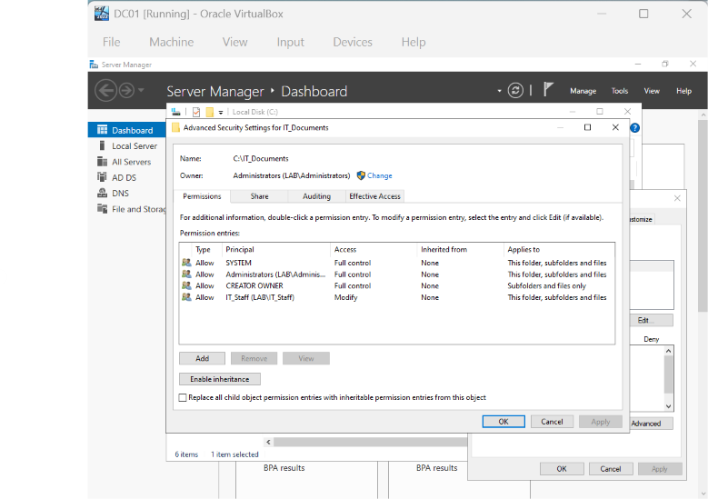
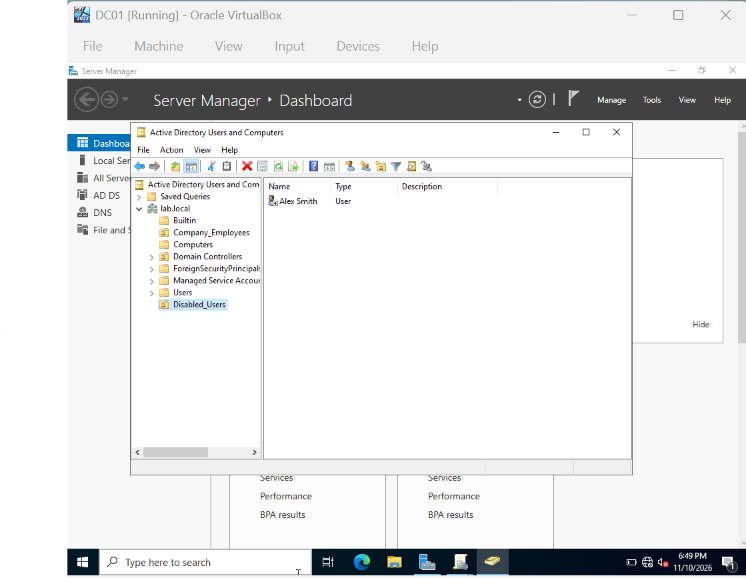
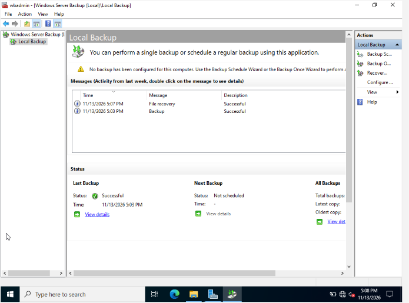

# Windows Server 2022: IT Infrastructure Lab

## Project Overview
Built a virtualized enterprise IT infrastructure environment using **Windows Server 2022** and **Windows 11 Enterprise** in Oracle VirtualBox to gain hands-on experience with core Microsoft infrastructure and system administration.

## Key Skills & Accomplishments
* **Windows Server 2022 Administration:** Provisioned and configured a Windows Server 2022 virtual machine (`DC01`) and promoted it to a root Domain Controller (`lab.local`).
* **Active Directory Domain Services (AD DS):** Built a structured Organizational Unit (`Company_Employees`), created corporate user accounts (`jdoe`), and managed security groups (`IT_Staff`).
* **Networking, DNS & IP Management:** Configured an isolated internal virtual network (`LabSandbox`), assigned static IPv4 addressing (`192.168.10.10` / `192.168.10.20`), and configured DNS name resolution so the Windows 11 client could locate and join the domain.
* **Group Policy (GPO) Management:** Created and linked a centralized Group Policy Object (`Block_Control_Panel`) to restrict Control Panel and PC Settings access for domain users.
* **Client Deployment & Troubleshooting:** Deployed a Windows 11 Enterprise workstation (`Client01`), resolved internal network adapter/firewall routing issues, and verified domain authentication and GPO enforcement.

## Lab Verification & Screenshots

### 1. Active Directory Users & Security Groups

### 2. Group Policy Management (GPO)

### 3. Domain-Joined Client Workstation

### 4. Group Policy Enforcement on Windows 11

### 5. Shared Folders & NTFS Permissions
- Created a centralized `IT_Documents` network share on `DC01` (`\\DC01\IT_Documents`).
- Restricted SMB Share permissions exclusively to the `IT_Staff` security group.
- Disabled NTFS inheritance and removed broad `Users` access to enforce least-privilege file security.

---

### 6. User Onboarding & Offboarding Lifecycle
- **Onboarding:** Provisioned a new employee account (`Alex Smith` / `asmith`), assigned `IT_Staff` group membership, and automatically mapped the `Z:` network drive to `\\DC01\IT_Documents`.
- **Offboarding:** Executed a standard security offboarding checklist by resetting the account password, revoking security group memberships, disabling the Active Directory account, and migrating it to a dedicated `Disabled_Users` quarantine OU.

---

### 7. Backup & Disaster Recovery
- Provisioned a dedicated secondary virtual disk (`E:`) and installed the **Windows Server Backup** feature on `DC01`.
- Executed a custom volume/folder backup of critical `IT_Documents` data.
- Simulated an accidental file deletion (`Confidential_Passwords.txt`) and successfully restored the file to its original location using Windows Server Backup Recovery.

